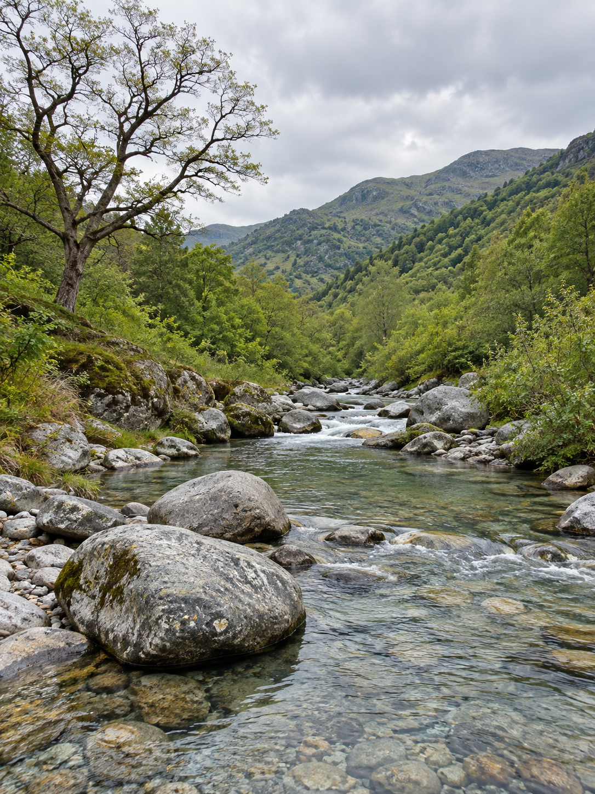
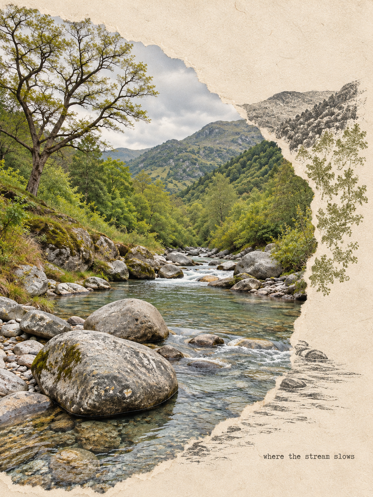

# 河图·撕纸风景明信片

把风景照片做成 **摄影 + 撕纸 + 同景版画** 的复古明信片。

v2.0.0｜面向 Codex 的图片技能。暖纸、原片细节、纤维撕口、景物接续与安静留白构成固定风格；12 个可调维度帮助不同照片保持同一视觉语言。

## 效果示例

以下原图和成品都是 AI 生成的测试素材，不是用户实拍，也不代表真实地点。测试没有传入六张第三方参考图，验证了公共包的文字规则路径。

| 合成测试原片 | 明信片输出 |
| --- | --- |
|  |  |

[提示词与测试结果](docs/validation.md)。单个案例不代表所有场景都已验证；生成式编辑不保证像素无损。

## 使用

上传一张风景照片，然后说：

> 用河图明信片，把这张照片做成撕纸版画风格。

也可以说：

- 保留这两只鸟，做无字版。
- 改成横版，点缀色取照片里的赭橙，文字是“沿街慢走”。
- 这五张做成同系列，纸底、墨色、字形与文字位置统一。
- 同一张图给我摄影主导和版画强调两版。

## 安装到 Codex

将仓库的 `skills/hetu-landscape-postcard` 文件夹放到 Codex 的 skills 目录（通常是 `~/.codex/skills/`）。已有版本先备份，保留自己添加的本地参考图。下一轮对话可调用 `$hetu-landscape-postcard`。

也可以让 Codex 执行：

> 从 https://github.com/wuhetu619-crypto/hetu-landscape-postcard 安装 skills/hetu-landscape-postcard。

需要当前环境可用的原生图像编辑工具。仅安装 Markdown 技能不会提供新的模型额度或 API 服务。

公共仓库不附带六张第三方参考原图；完整文字图谱与预设可独立工作。如果本机已有这些样图，放在技能的 `references/images/` 下即可按图谱选用，不能声称公共包自带了图片。

## v2 的内容

- **12 个设计维度**：内容锚点、构图、摄影占比、撕口形态、跨界连续、印刷工艺、纸材、颜色、光与明度、层次、文字、情绪与系列节奏。
- **6 个构图骨架、8 个场景预设**，区分原参考归纳和雪景/沙漠派生方案。
- **主体与参考分离**，先明确哪条山脊、檐线、道路或水纹延伸到哪里。
- **系列锁定与局部修改**，变体有明确变化轴。
- **质量检查与有限重试**，可观察的视觉依据与技术事实分别记录。
- **只读尺寸检查脚本**，读取 PNG/JPEG/WebP 文件头，不修改图像。

详细说明：[技能入口](skills/hetu-landscape-postcard/SKILL.md) · [对标与升级](docs/comparison.md) · [验证范围](docs/validation.md) · [第三方方法署名](THIRD_PARTY_NOTICES.md)

## 许可范围

公开可见不等于获得额外的内容授权。此仓库暂未为自有内容指定开源许可证；上游方法参考的许可与署名单列在第三方说明中。原片和第三方样图的权利由其各自权利人保留。
